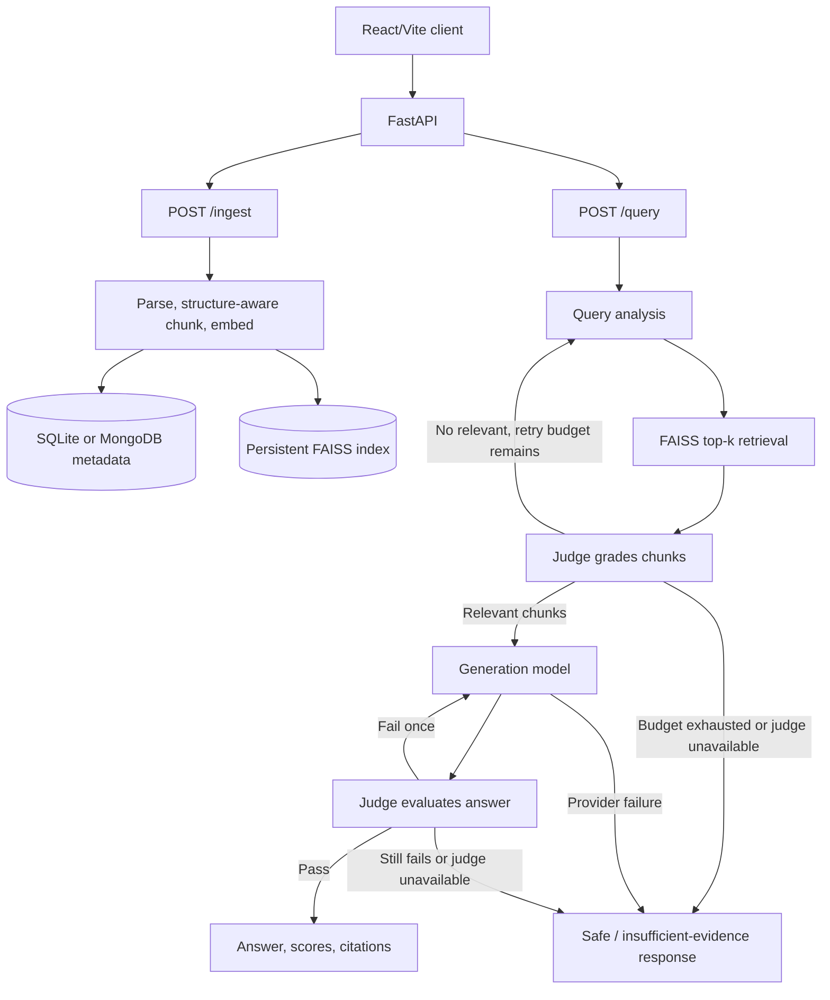

# DocuMind - Technical Documentation Assistant

DocuMind indexes Markdown, TXT, and HTML files or documentation URLs, then answers questions with citations to the indexed material. The backend uses Sentence Transformers, FAISS, LangGraph, FastAPI, and separately configured Gemini generation and judge models. The React/Vite frontend connects to the actual FastAPI endpoints.

## First-time setup (Windows PowerShell)

From the project root:

```powershell
python -m venv .venv
Set-ExecutionPolicy -Scope Process -ExecutionPolicy Bypass # only if PowerShell blocks activation
.\.venv\Scripts\Activate.ps1
python -m pip install --upgrade pip
python -m pip install -r requirements.txt
Copy-Item .env.example .env
```

Open `.env` and set `GEMINI_API_KEY`. The key stays on the backend. The default models are `gemini-3.1-flash-lite` for query rewriting and answer generation and `gemini-3.5-flash-lite` for document grading and answer evaluation. Both are lightweight models. On transient provider overloads, rate limits, or server errors, each call tries its role's configured `*_FALLBACK_MODELS` list; the default fallbacks use the other Flash-Lite model. Fallbacks cannot overcome a project-wide quota, invalid key, or provider outage affecting every model. MongoDB metadata is selected with `MONGODB_URI`; without it, SQLite is used.

Install the frontend once:

```powershell
cd frontend
npm install
Copy-Item .env.example .env
cd ..
```

## Start the app locally

Use two PowerShell terminals from the project root.

**Terminal 1 - backend:**

```powershell
.\.venv\Scripts\Activate.ps1
uvicorn main:app --reload --host 127.0.0.1 --port 8000
```

**Terminal 2 - frontend:**

```powershell
cd frontend
npm run dev
```

Open `http://localhost:5173`. The frontend API URL defaults to `http://127.0.0.1:8000`; change `VITE_API_BASE_URL` in `frontend/.env` if needed. Backend browser origins are controlled by `CORS_ORIGINS` in the root `.env`.

The first ingestion or query loads the configured local Sentence Transformer model if it is not cached yet. Keep the backend terminal open to see the step logs. `LOG_LEVEL=DEBUG` enables more verbose Python logging; frontend API request/response logs are enabled in Vite development mode and can be disabled with `VITE_DEBUG=false`.

## Included example corpus

The repository includes a four-page public FastAPI documentation corpus in [`corpus/sources.json`](corpus/sources.json). Fetch and index it after starting the backend dependencies:

```powershell
.\.venv\Scripts\Activate.ps1
python scripts/ingest_corpus.py
```

The script uses the existing `IngestionService` and stable source IDs; running it again skips unchanged pages. It does not need a Gemini key, but it does need network access to the listed documentation pages and the local embedding model.

## End-to-end smoke check

1. Open the app and select **Documents**.
2. Upload a PDF, DOCX, PPTX, XLSX, CSV, JSON, Markdown, TXT, or HTML file, or import a public documentation URL. Wait for the API response status (`indexed`, `updated`, or `already_indexed`) and refresh the document list. Scanned PDFs need OCR first; legacy `.doc` files are not supported.
3. Return to **Assistant**, ask a question answered by that document, and inspect the evaluation scores and source chunk.
4. Ask a follow-up in the same chat to exercise its session ID, then submit a thumbs-up/down rating.
5. Check `GET http://127.0.0.1:8000/health` and `GET http://127.0.0.1:8000/docs` if debugging the API separately.

Run backend tests from the activated venv:

```powershell
python -m pytest -q
```

## Debug logs

Logs are emitted to the backend terminal with timestamp, severity, module, and event. They include request IDs, endpoint timings, ingestion parse/chunk/embed/index/metadata steps, FAISS retrieval counts, LangGraph node/retry progress, Gemini model call duration, and evaluation scores. Prompts, document contents, questions, and API keys are not logged. Use a `request_id` to correlate HTTP request start/completion messages with the endpoint pipeline logs. The frontend logs API method, path, status, and request duration without logging request bodies.

## API and response shape

- `GET /health`
- `POST /query` with `{ "question": "...", "session_id": "..." }`
- `POST /query` with `"stream": true` (or `Accept: text/event-stream`) for server-sent progress and answer text on the same route. Progress is sent while retrieval/generation/evaluation runs. Answer tokens are sent only after evaluation passes.
- `DELETE /sessions/{session_id}` to remove a conversation and its stored feedback.
- `POST /ingest` with multipart field `file` or `url`
- `GET /documents`
- `POST /feedback` with the exact question and answer from a prior response, `rating` (`up` or `down`), and its `session_id`. Repeating a vote for the same answer updates it.

Successful query responses contain `answer`, nested `confidence` values (`overall`, `faithfulness`, `relevance`, `correctness`, `status`, reasons), and `sources` with actual document, section, and chunk IDs. The overall score is a grounded confidence indicator, not a calibrated probability. Unverified answers do not receive a successful confidence score.

Feedback is grouped under a canonical resolved question, with its distinct answers kept as a response list and each vote weighted `+1` or `-1`. Similarity uses `FEEDBACK_POSITIVE_SIMILARITY_THRESHOLD=0.72` for positive feedback and `FEEDBACK_NEGATIVE_SIMILARITY_THRESHOLD=0.80` for negative feedback. One net-positive vote can make an answer reusable when its confidence is at least `MINIMUM_OVERALL_SCORE` (75 by default) and its cited chunks are still current. A net score below `-1` returns insufficient evidence only when the group's mean confidence on downvoted answers is below that threshold and the corpus has not changed. A session can vote once per question/answer; submitting another rating for that same answer changes the existing vote. Follow-up feedback is attached to the resolved standalone question while the original prompt is retained for conversation history. When ingestion replaces or removes chunks, feedback and conversation exchanges citing those chunks are deleted. Answers keep source details in the source list and omit inline `[S1]` markers.

Example request:

```powershell
curl.exe -X POST http://127.0.0.1:8000/query `
  -H "Content-Type: application/json" `
  -d '{"question":"How do I declare a FastAPI dependency?","session_id":"demo-session"}'
```

Successful response shape (values and IDs below are illustrative):

```json
{
  "answer": "Declare a dependency with Depends() in the path operation.",
  "confidence": {
    "overall": 92,
    "faithfulness": 95,
    "relevance": 90,
    "correctness": 90,
    "status": "passed",
    "reasons": {
      "faithfulness": "The claim is supported by the cited documentation.",
      "relevance": "The response addresses the question.",
      "correctness": "The response matches the supplied evidence."
    },
    "unsupported_claims": []
  },
  "sources": [
    {
      "document": "dependencies",
      "section": "Dependencies",
      "chunk_id": "<stored-chunk-id>",
      "document_id": "fastapi:dependencies",
      "source_url": "https://fastapi.tiangolo.com/tutorial/dependencies/"
    }
  ],
  "session_id": "demo-session",
  "status": "passed",
  "retry_count": 0,
  "generation_retry_count": 0,
  "fallback_used": false,
  "error": null
}
```

Ingest a local file and submit feedback:

```powershell
curl.exe -X POST http://127.0.0.1:8000/ingest -F "file=@docs/guide.md"
curl.exe -X POST http://127.0.0.1:8000/feedback `
  -H "Content-Type: application/json" `
  -d '{"question":"How do I declare a FastAPI dependency?","rating":"up","session_id":"demo-session","answer":"Declare a dependency with Depends() in the path operation."}'
curl.exe http://127.0.0.1:8000/documents
```

`POST /ingest` returns the ingestion status and chunk counts, for example `{"document_id":"file:...","status":"indexed","chunk_count":4,"added_chunks":4,...}`. `POST /feedback` returns a feedback ID and status (`recorded` or `updated`). `GET /documents` returns a `documents` array containing document metadata and each document's chunk count.

## Architecture



## Design decisions, assumptions, and tradeoffs

- **Chunking and embeddings:** headings establish section boundaries; paragraphs and lists are grouped within a section, while fenced code and Markdown tables are kept intact when possible. Long prose is split near sentence/line boundaries with configurable character overlap. `all-MiniLM-L6-v2` creates normalized local embeddings for both ingestion and queries. This keeps inference local and lightweight; character-based chunk sizes are simple but less precise than token-based sizing.
- **Index consistency:** SQLite (or MongoDB when configured) stores metadata and embedding vectors. Each update stages a replacement FAISS index, commits metadata, then promotes the index file. At startup FAISS is rebuilt from stored vectors to recover from an interrupted promotion. This favors straightforward recovery for a small corpus; rebuilding the flat index costs more as the corpus grows.
- **Identity and updates:** local files use their resolved paths, URLs use normalized URLs, and the corpus script supplies stable explicit IDs. Document hashes skip unchanged sources; unchanged chunk hashes retain their vector IDs and embeddings.
- **Grounding:** a separate judge model grades chunks and evaluates generated answers. Similarity scores are used only to order retrieval candidates; they are not presented as answer confidence. A bounded retry policy avoids unbounded graph loops, and unavailable judges never mark an answer passed.
- **Assumptions:** source URLs are reachable public HTTP(S) documentation, local files are UTF-8, and the service runs as a local development assignment without user authentication. Gemini credentials are supplied only to the backend environment.
- **Scope and tradeoffs:** web search fallback is intentionally omitted, so the assistant returns insufficient evidence when its corpus cannot support an answer. MongoDB stores document/chunk metadata when configured; conversation history and feedback remain in the local SQLite app store.
- **With more time:** add authenticated multi-user storage, token-aware chunk sizing, corpus versioning/deletion endpoints, retrieval/evaluation benchmarks, and integration tests against a disposable FAISS/SQLite store. Keep a curated offline corpus snapshot alongside the fetch manifest for fully offline demos.

The frontend stores session IDs and chat history locally for convenient navigation. The backend independently stores session conversation history used to resolve follow-up questions. A valid, strongly upvoted answer may be reused when its source chunks are still current; other questions continue through retrieval. Feedback is stored separately from generation.
